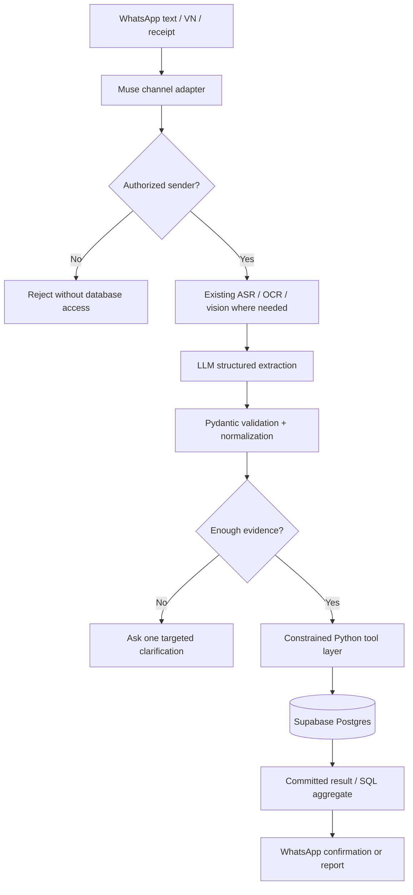
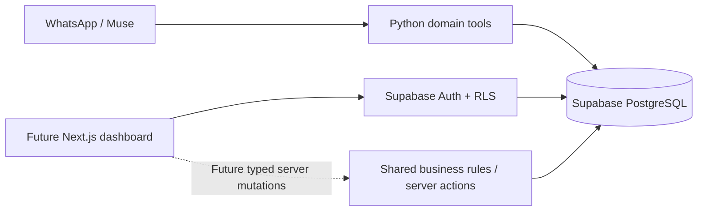

# Architecture — Muse/WhatsApp ↔ Supabase

## 1. Current architecture: MVP



**Trust boundary:** Everything originating in WhatsApp, images, transcripts, or LLM output is untrusted input. A server-owned Python adapter must authorize sender, map to a fixed `user_id`, validate types and bounds, then call Supabase. Never allow the model to execute arbitrary SQL, supply `user_id`, or see secret credentials.

## 2. Components and responsibilities

| Component | Responsibility | Should NOT do |
|---|---|---|
| WhatsApp/Muse adapter | Decode authenticated sender metadata, message ID, original timestamp, media pointer, send replies | Determine user identity from a user-typed phone number |
| Existing ASR / vision | Convert VN/receipt to text or structured observations | Persist canonical transaction rows |
| LLM extraction | Classify expense intent, suggest fields, flag ambiguity, explain query results | Compute authoritative totals or insert SQL itself |
| Validation/application service | Pydantic schemas; timezone parsing; amount normalization; category mapping; duplicate handling; mutations | Trust model-provided IDs without checking ownership |
| Supabase repository | Parameterized CRUD and restricted report RPC/query | Accept arbitrary query string from WhatsApp |
| PostgreSQL | Constraints, uniqueness, ownership, durable rows, deterministic aggregate | Store reasoning/memory as ledger |

For small personal scale, **do not create an HTTP API or deploy FastAPI yet**. Implement portable Python services callable from Muse's actual tool mechanism. If the Muse runtime cannot run Python tools, write a thin authenticated webhook/Edge Function adapter **only after verifying the platform's actual integration contract**; document the reason.

## 3. Proposed code layout (target, not existing files)

```text
expense-tracker/
├── AGENTS.md
├── docs/
│   ├── PRD.md
│   ├── ARCHITECTURE.md
│   ├── DATA_MODEL.md
│   ├── TOOL_CONTRACT.md
│   ├── TEST_PLAN.md
│   └── DASHBOARD_ROADMAP.md
├── src/expense_tracker/
│   ├── config.py
│   ├── schemas.py
│   ├── parser.py
│   ├── authorization.py
│   ├── service.py
│   ├── reporting.py
│   ├── repository.py
│   └── muse_adapter.py      # ONLY if supported by real Muse runtime
├── supabase/migrations/
├── tests/
│   ├── unit/
│   ├── integration/
│   └── fixtures/
├── .env.example
└── pyproject.toml
```

Keep dependencies minimal: Python 3.11+, Pydantic, Supabase Python SDK, testing framework; reuse upstream audio/vision pipeline. No new OCR or Whisper installation unless an inspected environment truly requires it.

## 4. Connection choice

- From a Python tool/server in a trusted environment: **Supabase Python client over HTTPS Data API** is default. No database port, connection pool, or custom REST server needed.
- SQL migrations/deployment: Supabase CLI migrations (not LLM-generated runtime DDL).
- Direct Postgres/SQLAlchemy can be reconsidered if complex transactional use cases appear; not required to record a few dozen daily expenses.
- Prefer a **dedicated Supabase project** for finance data (not CareerOS).

## 5. Authentication and authorization

1. The owner creates/uses **one Supabase Auth user**. Its immutable UUID is `FINANCE_OWNER_USER_ID` on the trusted server, and `user_id` in rows. The same Auth user will log into the future dashboard.
2. Only message metadata from the **trusted WhatsApp provider/Muse adapter** determines sender identity. If receiving a public webhook, first verify the provider signature/authentication and reject replay/forgery; then compare sender to `ALLOWED_WHATSAPP_SENDER_IDS`. Never trust self-declared names/numbers in chat.
3. Only the authorized sender can invoke read/write tools. The adapter injects server-owned `user_id` into every operation.
4. Store `SUPABASE_URL` and a **server-only secret API key** outside repository/source/prompts. Secret keys can bypass RLS, so server-side identity and per-record authorization are mandatory in addition to PostgreSQL RLS.
5. Enable RLS for every exposed personal table; future browser only receives a publishable key, Auth session, and the owner's RLS-constrained rows. No admin/secret key in browser.
6. Configure narrow grants, test anonymous and cross-user denial. Any SQL functions in an exposed schema must have restricted `EXECUTE` privileges; avoid unsafe `SECURITY DEFINER` functions.

## 6. End-to-end ingestion and acknowledgment

1. Authenticated envelope arrives (`sender_id`, stable `message_id`, `sent_at`, modality).
2. Reject unauthorized sender **before** financial data reads/writes.
3. For VN/photo reuse available ASR/vision. Preserve `message_id` and original `sent_at`.
4. LLM emits strictly structured candidate(s). The code—not model—normalizes amounts/time and rejects invalid fields.
5. If amount/purchase intent ambiguous, ask clarification; do not create an expense yet. Short-lived Muse conversation context may hold an **unsaved draft**, but if context is lost, request that the user restate the details. Never pass a chat-memory draft off as a database record.
6. Check same-message idempotency; attempt insert with unique `(user_id, source_platform, source_message_id, source_item_index)`.
7. On unique conflict, fetch the existing row and respond `already_recorded`, never overwrite its fields accidentally.
8. On network timeout after possible write, requery by the same idempotency key before retrying. Never claim definite failure or success without checking.
9. Reply with the saved record(s) and stable ID only on confirmed persistence.

**Multiple purchases in one message:** indices `0..n-1` must be deterministic by source order. Perform a single batch insert where practical; if only partial success is possible, return exact per-item statuses and reconcile before acknowledgment. Do not silently report the entire batch as saved.

**Correction:** Locate candidate by persisted ID or constrained recent list. If >1 plausible target, ask the user to choose. An `update_expense` mutation verifies owner and active status. `delete_expense` performs soft-delete; report excludes soft-deleted rows.

## 7. Reporting pipeline

The requested `period` is resolved in the service using the original request's WIB timestamp, and converted to **UTC inclusive lower/exclusive upper** boundaries for `timestamptz` filtering. SQL (`SUM(amount_idr)`, `COUNT(*)`, `GROUP BY category_code`) produces authoritative totals. Format rupiah and human-readable categories **after** receiving the structured query result. Do not ask the LLM to add raw row amounts.

- Today/yesterday: WIB calendar day.
- This/last week: Monday through Sunday WIB.
- This/last month: WIB calendar month.
- Custom ranges: explicit start/end dates WIB, inclusive calendar dates converted to half-open timestamps.
- Include `period_start`, `period_end_exclusive`, `timezone`, `total_idr`, `count`, `by_category` in tool result.
- For no stored transactions, say "no records for the period" rather than asserting that no real expenses happened.

## 8. Failure, recovery, and privacy

- Timeouts: bounded retry/backoff with idempotent write keys; handle unknown result by verification.
- DB unavailable: visible failure; no storing in LLM memory as a substitute. Optional local retry queue is Phase 2, with encryption and lifecycle policy if introduced.
- Schema migrations in Git, applied through CLI; never let chat run DDL.
- Backups: regular off-platform logical dumps and an actual restore drill. Free Supabase projects do not receive automatic daily backups and can pause for inactivity; do not treat hosting as a substitute for backup.
- Keep receipt images/audio/transcriptions out of PostgreSQL and logs by default. Store only normalized financial fields and provenance metadata; source details are references, not permanent raw media.
- Structured, sanitized logs with request ID, status, latency; never print Supabase keys, complete media, or personal financial rows.

## 9. Dashboard-ready boundary



The **shared contract** is the PostgreSQL schema, canonical categories, period semantics, and validation rules. Do not couple database records to Muse prompt format. The Next.js dashboard is documented in `DASHBOARD_ROADMAP.md` only—no scaffold or component build in the MVP.

## 10. Design-level open points

- Confirm actual Muse tool registration/calling format from live workspace docs/code.
- Confirm source IDs/timestamps provided by WhatsApp bridge and whether forwarded media IDs are stable.
- Confirm Supabase credentials, owner Auth UUID, project and deployment workflow.
- Choose secure off-site backup location; schedule not required for initial proof-of-concept but must exist before relying on real data long-term.

## 11. Official references (checked 2026-11-01)

- [Supabase API keys — secret versus publishable](https://supabase.com/docs/guides/getting-started/api-keys)
- [Supabase RLS and authorization policies](https://supabase.com/docs/guides/database/postgres/row-level-security)
- [Securing the Data API — grants and function execution](https://supabase.com/docs/guides/api/securing-your-api)
- [Versioned database migrations](https://supabase.com/docs/guides/deployment/database-migrations)
- [Supabase backups and free-plan responsibilities](https://supabase.com/docs/guides/platform/backups)
- [Free-project inactivity and pausing](https://supabase.com/kb/faqs/platform/free-project-pausing)

Before deployment, recheck documentation for current platform behavior instead of assuming quotas, default grants, or pause rules never change.
