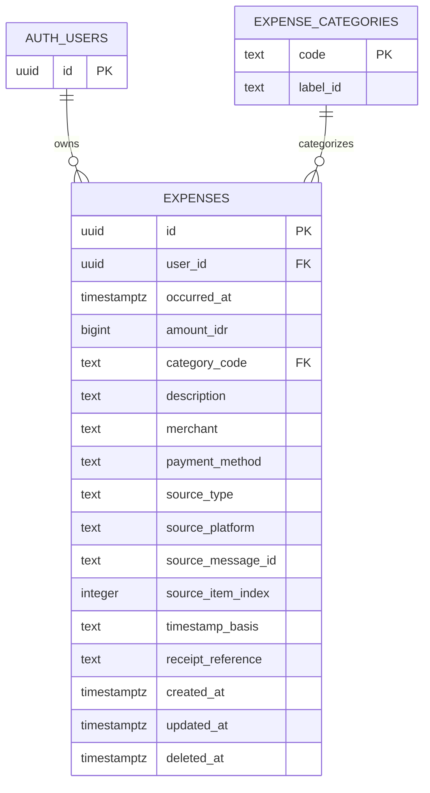

# Data Model — Supabase PostgreSQL

## 1. Design goals

- One durable record per expense, IDR integers, stable owner ID, and WhatsApp idempotency.
- Correct daily/weekly/monthly reporting in `Asia/Jakarta` while storing `timestamptz`.
- Retain the same tables when a Next.js dashboard is introduced.
- Keep MVP small: **two tables** (`expense_categories`, `expenses`); audit event table and receipt line items are future extensions.

## 2. Entity relationships



**Owner:** For MVP create one account in Supabase Auth; bind its `auth.users.id` to a server-side `FINANCE_OWNER_USER_ID`. Future dashboard signs in as *the same Auth user*. No account conversion needed.

## 3. Canonical schema (migration blueprint)

The coding agent must generate and test a **versioned SQL migration** equivalent to this schema, including triggers/grants/RLS policies, rather than manually editing the remote database. Names and checks below form the contract.

```sql
create table public.expense_categories (
    code text primary key,
    label_id text not null,
    is_active boolean not null default true
);

insert into public.expense_categories (code, label_id) values
 ('food_drink', 'Makanan & Minuman'),
 ('transport', 'Transportasi'),
 ('groceries', 'Belanja Kebutuhan'),
 ('bills', 'Tagihan'),
 ('shopping', 'Belanja Lainnya'),
 ('health', 'Kesehatan'),
 ('entertainment', 'Hiburan'),
 ('education', 'Pendidikan'),
 ('other', 'Lainnya');

create table public.expenses (
    id uuid primary key default gen_random_uuid(),
    user_id uuid not null references auth.users(id),
    occurred_at timestamptz not null,
    amount_idr bigint not null check (amount_idr > 0),
    category_code text not null references public.expense_categories(code),
    description text not null check (length(btrim(description)) between 1 and 500),
    merchant text check (merchant is null or length(merchant) <= 200),
    payment_method text not null default 'unknown'
      check (payment_method in
        ('cash','qris','bank_transfer','debit_card','credit_card','e_wallet','unknown')),
    source_type text not null
      check (source_type in ('text','voice','receipt','dashboard')),
    source_platform text not null
      check (source_platform in ('whatsapp','dashboard')),
    source_message_id text not null check (length(source_message_id) between 1 and 255),
    source_item_index integer not null default 0 check (source_item_index >= 0),
    timestamp_basis text not null
      check (timestamp_basis in ('receipt','user_explicit','message_time')),
    receipt_reference text check (receipt_reference is null or length(receipt_reference) <= 200),
    created_at timestamptz not null default now(),
    updated_at timestamptz not null default now(),
    deleted_at timestamptz,
    constraint expenses_source_unique unique
      (user_id, source_platform, source_message_id, source_item_index)
);

create index expenses_user_occurred_idx
    on public.expenses (user_id, occurred_at desc)
    where deleted_at is null;
create index expenses_user_category_occurred_idx
    on public.expenses (user_id, category_code, occurred_at desc)
    where deleted_at is null;
```

### `updated_at`

Migration must add a DB trigger setting `updated_at = now()` for updates. Never rely exclusively on client clocks. `deleted_at` is a soft-delete timestamp; a restore sets it to `NULL`.

### Why not `expense_items` now?

For a receipt with five goods, treat the **receipt paid total** as one record. If item-level breakdown is later requested, add `expense_items(expense_id, label, quantity, unit_price_idr, total_idr)` in another migration, with explicit reconciliation against the parent total. Don't let an MVP agent store line items *and* parent grand total as separate expenses.

## 4. Timestamp and reporting semantics

- `occurred_at`: purchase moment as `timestamptz` (stored in UTC internally), irrespective of when the record was entered.
- Source priority: explicit receipt timestamp > user-described timestamp > trusted message timestamp. If receipt date is clearly wrong/contradicts user, ask.
- `timestamp_basis`: which evidence set the time; distinguishes precise merchant time vs fallback.
- Interpret colloquial `kemarin` relative to original message's **WIB** date. When user gives a date without clock time, choose a documented neutral hour (e.g., local noon) and mark `user_explicit`; the report uses date anyway. Do not falsely claim exact clock precision in chat.
- SQL report filter uses precise half-open UTC boundaries computed from local WIB start/end: `occurred_at >= :start_utc AND occurred_at < :end_utc`.
- `this week` = Monday 00:00 WIB to next Monday 00:00 WIB. Monthly calendar boundaries; no naive `now() - interval '30 days'` for calendar months.
- Include amounts only if `deleted_at is null`. Rows backfilled late are grouped by `occurred_at`, not `created_at`.
- Use `bigint` in PostgreSQL and Python `int`; output JSON numbers remain whole IDR (no fractional rupiah).

## 5. Category and payment rules

- Categories are **controlled codes** above; `other` if unknown. Keep a translated label for display.
- `payment_method='unknown'` unless evidence supports cash/QRIS/etc; no inference solely from merchant.
- Total spending counts all payment methods once. No separate payment-account balances in MVP.
- `receipt_reference` may capture printed order/receipt ID but is not guaranteed unique across merchants; **do not use it as primary key**.
- No `currency` column in MVP because all rows are contractually IDR; future currency support requires a migration and FX policy before mixing totals.

## 6. User authorization / RLS and grants

**Required security behavior:**

- Enable RLS on both tables (where applicable) in the exposed schema.
- `anon` cannot select, insert, update, or delete personal expenses.
- `authenticated` may SELECT **only** rows where `user_id = (select auth.uid())` at MVP; browser-side writes are not authorized until a reviewed dashboard mutation path exists.
- Backend's server-only secret key has elevated privilege, so it **must** independently validate WhatsApp sender and filter by server-derived `user_id` on every query and mutation (including `id + user_id` update filter).
- Grant only needed privileges explicitly. Audit default grants and `PUBLIC` function execution so RPC functions are not unintentionally reachable.
- Category codes/labels may be readable to authenticated users. RLS on categories should allow reading valid codes but not write from browser.
- Add RLS tests verifying owner A can read their own records, user B gets none, and unauthenticated client gets none.

**Example conceptual policy** (migration must include full grants and negative tests):

```sql
alter table public.expenses enable row level security;
create policy expenses_owner_read on public.expenses
  for select to authenticated
  using (user_id = (select auth.uid()));
```

For Supabase, a backend **secret key bypasses RLS**: do not treat RLS as defense against a compromised tool runtime.

## 7. Query contract

**Report input:** `(user_id_from_server, local_start_date, local_end_date_inclusive, timezone='Asia/Jakarta', optional category)`.

**Report output:** period metadata, `total_idr`, `transaction_count`, `by_category`, and optionally the N most recent expenses. SQL must use `SUM(amount_idr)`, `COUNT(*)`, `GROUP BY category_code` on filtered active rows. Agent may implement an intentionally restricted PostgreSQL RPC returning structured JSON/rows or parameterized server-side SQL. SQL must be static—not model-generated and not string-concatenated from user input. Do not fetch an unbounded lifetime dataset to the LLM for arithmetic.

Example aggregation SQL (inside server-managed parametrized function/driver; **not** a user query API):

```sql
select category_code,
       count(*)::bigint as transaction_count,
       coalesce(sum(amount_idr), 0)::bigint as total_idr
from public.expenses
where user_id = :user_id
  and deleted_at is null
  and occurred_at >= :utc_start
  and occurred_at < :utc_end
  and (:category_code is null or category_code = :category_code)
group by category_code
order by total_idr desc, category_code;
```

If using Supabase Python SDK, implement a **restricted report RPC with explicit EXECUTE grants**, or a bounded, validated server-side report query; do not claim `.select()` is itself a SQL GROUP BY API.

## 8. Evolution without migration headaches

Future dashboard uses the **same** `expenses.user_id`, timestamp, category codes, and deletion semantics. Dashboard-created records set `source_type='dashboard'`, `source_platform='dashboard'`, and a backend-generated stable `source_message_id` (idempotency key). Category codes remain immutable even if UI labels change. Add schema changes with forward-compatible migrations only.

**Later, not MVP:** multi-user WhatsApp identity mapping table, receipt-item table, audit log / event ledger, transactions split between accounts, budgets, export views, merchant normalization.
